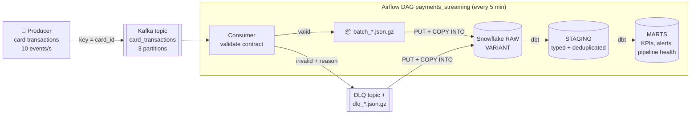
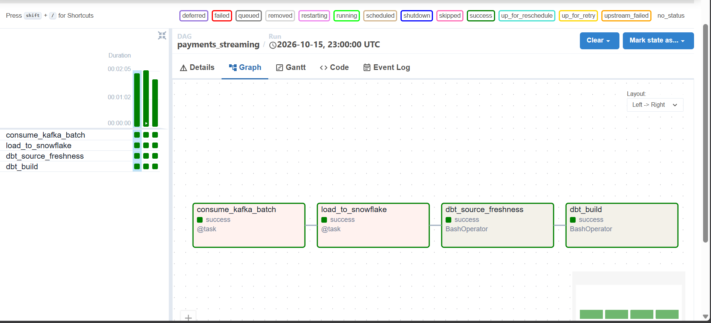

# ⚡ Real-Time Payments Pipeline: Kafka → Airflow → Snowflake → dbt


A streaming data pipeline for **card transactions**:

- Events are published to **Kafka** in real time.
- **Airflow** collects them into micro-batches every 5 minutes, validates them and loads them into **Snowflake**.
- **dbt** turns the raw JSON into deduplicated, tested tables for fraud monitoring.

It is built to handle the problems real streams have: **malformed messages, duplicate deliveries, failed loads and late data**.

> Companion projects: [card-fraud-detection](https://github.com/bairipoojitha1299/card-fraud-detection) (the fraud model on the same data) · [olist-elt-pipeline](https://github.com/bairipoojitha1299/olist-elt-pipeline) (batch ELT with Airflow + dbt).

---

## 🧭 Architecture



**Airflow DAG `payments_streaming`:** `consume_kafka_batch → load_to_snowflake → dbt_source_freshness → dbt_build`

## 📸 A real run

The DAG running on Docker Desktop against a Snowflake trial account. All four tasks succeeded on every scheduled run:



The first three micro-batches:

| Batch (UTC) | Valid events → Snowflake | Rejected → dead-letter queue |
|---|---:|---:|
| 23:08 | 6,852 | 67 |
| 23:10 | 1,173 | 11 |
| 23:12 | 1,350 | 13 |

- **9,375 events loaded**, and **91 malformed messages (~1%) quarantined** with their reasons instead of breaking the load.
- `dbt build` passed: **6 models built, 16 data tests passed**, including the proof that duplicates were removed.
- `dbt source freshness` passed: the newest data was **11 seconds old** when the check ran.

## 🛡️ How it handles real-world stream problems

| Problem | What the pipeline does |
|---|---|
| **Malformed or invalid messages** (bad JSON, missing fields, negative amounts, unknown categories) | Every message is checked against an **event contract** ([`streaming/schema.py`](streaming/schema.py)). Failures go to a **dead-letter topic** and to a `RAW.CARD_TRANSACTIONS_DLQ` table *with the reason*, so they are quarantined, not lost. |
| **Duplicate deliveries** | Kafka is used **at-least-once**: offsets are committed only *after* the batch file is safely written. Duplicates are removed in Snowflake with `QUALIFY ROW_NUMBER() OVER (PARTITION BY event_id ...)`, and a dbt test proves every event appears exactly once. |
| **A load fails halfway** | Each run loads *all* pending files, and Snowflake's load metadata skips files it already loaded, so retries are **idempotent**. |
| **The stream stops** | `dbt source freshness` warns after 15 minutes without new data and fails after 60. |
| **Per-card ordering** | Messages are keyed by `card_id`, so a card's transactions stay in order within one partition. |
| **Busy topic** | A batch closes at 10,000 messages, after 10s of silence, or after 60s, whichever comes first. |
| **Personal data** | Names, addresses and dates of birth never leave the producer (data minimisation). |
| **Credentials** | Snowflake access uses a **key-pair service user** with a least-privilege role. Secrets live in a git-ignored `.env`. |

The producer has a `--chaos` switch that deliberately injects broken and duplicate messages (2% by default), so these defences are exercised all the time, not just in theory.

## ❄️ Snowflake + dbt layer

| Layer | Object | What it is |
|---|---|---|
| RAW | `CARD_TRANSACTIONS`, `CARD_TRANSACTIONS_DLQ` | JSON payload in a `VARIANT` column + source file + load time |
| STAGING | `stg_card_transactions` | typed columns, **deduplicated**, **incremental merge** on `event_id` |
| STAGING | `stg_dead_letters` | one row per validation error (`LATERAL FLATTEN`) |
| MARTS | `mart_fraud_kpis_hourly` | volume, value, fraud rate per hour |
| MARTS | `mart_category_risk` | fraud rate and amounts by merchant category |
| MARTS | `mart_card_alerts` | streaming rule alerts (spend spike vs card history, 3 transactions in 10 minutes, large night-time purchase) with the reason and confirmed outcome, so rule precision can be tracked |
| MARTS | `mart_pipeline_health` | per batch: events, rejected %, **end-to-end latency** (Kafka → queryable in Snowflake) |

dbt tests check unique and non-null keys, accepted categories, *no negative amounts reach the warehouse*, and *raw distinct events = staged events* (proof of deduplication).

## ✅ Testing and CI

GitHub Actions runs on every push:

- **Unit tests:** the event contract, every injected fault type is rejected, batch splitting, file landing and the loader's routing.
- **Kafka integration test against a real broker:** produces 400 events with 10% faults and duplicates, consumes a micro-batch, then checks that nothing was lost, faults reached the DLQ, duplicates exist before dedup, and offsets were committed.
- **`dbt parse`** with the Snowflake adapter, plus a DAG compile check.

## ▶️ Run it yourself

**You need:** [Docker Desktop](https://www.docker.com/products/docker-desktop/) and a free [Snowflake trial](https://signup.snowflake.com/).

1. **Snowflake:** open a Snowsight worksheet and run [`snowflake/setup.sql`](snowflake/setup.sql). Copy the account identifier it prints at the end.
2. **Config:** copy `.env.example` to `.env` and set `SNOWFLAKE_ACCOUNT`.
3. **Key pair:** run
   ```bash
   docker compose run --rm airflow python /opt/airflow/scripts/generate_keypair.py
   ```
   Then run the `ALTER USER ... RSA_PUBLIC_KEY = ...` statement it prints in Snowflake.
4. **Start everything:**
   ```bash
   docker compose up -d --build
   ```
5. **Watch it work:**
   - **Kafka UI** at http://localhost:8085 shows messages arriving on `card_transactions` and the DLQ.
   - **Airflow** at http://localhost:8080 (airflow / airflow): unpause `payments_streaming`.
   - **Snowflake:** run `SELECT * FROM PAYMENTS.MARTS.MART_PIPELINE_HEALTH ORDER BY LOADED_AT DESC;`
6. **Stop:** run `docker compose down`. The warehouse auto-suspends after 60 seconds, so the trial credits last.

## 🚀 What I'd change for production

- Swap the micro-batch loader for the **Snowflake Kafka connector / Snowpipe Streaming** when seconds-level latency is needed. The dbt layer stays the same.
- Move the event contract into a **Schema Registry** (Avro/Protobuf) with compatibility rules.
- Run Kafka with 3 brokers and replication factor 3, and run Airflow with the Celery or Kubernetes executor.
- Send DLQ and freshness alerts to Slack or PagerDuty.

## 📁 Project structure

```
payments-streaming-pipeline/
├── streaming/
│   ├── schema.py            # event contract + validation
│   ├── producer.py          # replays transactions into Kafka (keyed, idempotent)
│   ├── chaos.py             # fault injection
│   ├── consumer.py          # micro-batch consumer, DLQ, at-least-once commits
│   └── snowflake_loader.py  # PUT + COPY INTO, key-pair auth, idempotent
├── dags/payments_streaming_dag.py   # Airflow TaskFlow DAG
├── dbt/payments/            # staging + marts + tests (Snowflake)
├── snowflake/setup.sql      # warehouse, database, role, service user
├── scripts/generate_keypair.py
├── docker/                  # Airflow and producer images
├── docker-compose.yml       # Kafka (KRaft) + Kafka UI + producer + Airflow
├── tests/                   # pytest: unit + Kafka integration
└── data/sample/             # 20,000 sample transactions (no personal fields)
```

## 📚 Data

The transactions come from the [Credit Card Transactions Fraud Detection Dataset](https://www.kaggle.com/datasets/kartik2112/fraud-detection), which is simulated data. A 20,000-row sample without personal fields is included and replayed in a loop, with fresh event IDs and timestamps.
